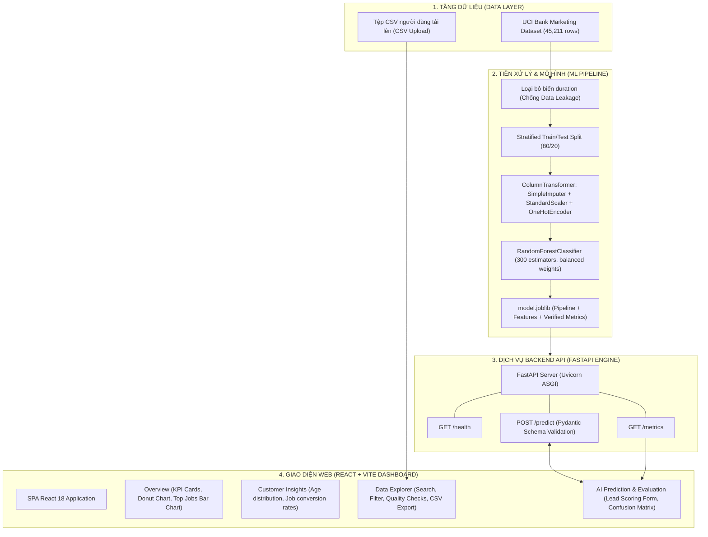

# BÁO CÁO ĐỒ ÁN KỸ THUẬT & KHOA HỌC DỮ LIỆU
## HỆ THỐNG PHÂN TÍCH DỮ LIỆU CHIẾN DỊCH & DỰ ĐOÁN ĐĂNG KÝ TIỀN GỬI NGÂN HÀNG (BANK MARKETING ANALYTICS & PREDICTION SYSTEM)

---

### MỤC LỤC
1. [TỔNG QUAN ĐỒ ÁN (EXECUTIVE SUMMARY)](#1-tổng-quan-đồ-án-executive-summary)
2. [KIẾN TRÚC HỆ THỐNG TOÀN DIỆN (SYSTEM ARCHITECTURE)](#2-kiến-trúc-hệ-thống-toàn-diện-system-architecture)
3. [DỮ LIỆU & PHÂN TÍCH KHÁM PHÁ (EDA - EXPLORATORY DATA ANALYSIS)](#3-dữ-liệu--phân-tích-khám-phá-eda)
4. [TIỀN XỬ LÝ DỮ LIỆU & CHỐNG RÒ RỈ THÔNG TIN (PREPROCESSING & DATA LEAKAGE PREVENTION)](#4-tiền-xử-lý-dữ-liệu--chống-rò-rỉ-thông-tin)
5. [HUẤN LUYỆN & ĐÁNH GIÁ MÔ HÌNH MACHINE LEARNING (MODEL EVALUATION)](#5-huấn-luyện--đánh-giá-mô-hình-machine-learning)
6. [THIẾT KẾ & TRIỂN KHAI PHẦN MỀM (FULL-STACK APPLICATION)](#6-thiết-kế--triển-khai-phần-mềm)
7. [HƯỚNG DẪN CÀI ĐẶT & VẬN HÀNH (OPERATIONS & DEPLOYMENT)](#7-hướng-dẫn-cài-đặt--vận-hành)
8. [HẠN CHẾ & HƯỚNG PHÁT TRIỂN TIẾP THEO (LIMITATIONS & FUTURE WORK)](#8-hạn-chế--hướng-phát-triển-tiếp-theo)
9. [KẾT LUẬN (CONCLUSION)](#9-kết-luận-conclusion)

---

### 1. TỔNG QUAN ĐỒ ÁN (EXECUTIVE SUMMARY)

* **Tên đồ án:** Hệ thống Phân tích Chiến dịch Tiếp thị & Dự đoán Khả năng Đăng ký Tiền gửi có Kỳ hạn của Khách hàng Ngân hàng (Bank Marketing Intelligence Dashboard & Inference System).
* **Nguồn dữ liệu:** Bộ dữ liệu chuẩn khoa học **Bank Marketing Dataset** từ Trung tâm Học máy UCI (*University of California, Irvine*), thu thập từ các chiến dịch tiếp thị qua điện thoại trực tiếp (direct telemarketing campaigns) của một tổ chức ngân hàng Bồ Đào Nha (tổng cộng 45.211 bản ghi và 17 thuộc tính).
* **Vấn đề cốt lõi:**
  * Ngân hàng tốn kém rất nhiều chi phí nhân sự và thời gian gọi điện (cold calling) nhưng tỷ lệ khách hàng đồng ý mở sổ tiết kiệm có kỳ hạn (`y = yes`) chỉ chiếm xấp xỉ **11.7%**.
  * Cần có một hệ thống trực quan hóa toàn diện hành vi khách hàng, hỗ trợ import dữ liệu CSV mới để kiểm tra chất lượng dữ liệu, đồng thời tích hợp mô hình Machine Learning phân loại chính xác khách hàng tiềm năng **trước khi nhân viên tiếp thị bấm máy liên lạc**.
* **Kết quả đạt được:**
  * Xây dựng pipeline tiền xử lý chống rò rỉ dữ liệu (*Data Leakage Prevention*), loại bỏ triệt để biến hậu cuộc gọi `duration`.
  * Huấn luyện mô hình `RandomForestClassifier` (300 cây) giải quyết bài toán mất cân bằng nhãn (*Class Imbalance*) đạt **ROC-AUC = 80.28%**, **Recall = 53.40%**, **Accuracy = 86.23%**.
  * Đóng gói mô hình thành dịch vụ RESTful API tốc độ cao với **FastAPI**, kết nối liền mạch với giao diện điều khiển **React 18 + Vite** theo chuẩn thiết kế Enterprise Analytics.

---

### 2. KIẾN TRÚC HỆ THỐNG TOÀN DIỆN (SYSTEM ARCHITECTURE)

Hệ thống được thiết kế theo mô hình phân tầng hướng dịch vụ (Decoupled Microservices / Client-Server Architecture):



#### Phân nhiệm các tầng:
1. **Tầng Dữ liệu & Huấn luyện (Offline Training & Preprocessing):**
   * Huấn luyện độc lập bằng Python, thực hiện chuẩn hóa số học, mã hóa biến phân loại và lưu trữ toàn bộ tham số vào tệp `backend/model.joblib`.
2. **Tầng Dịch vụ API (Inference Engine):**
   * Xây dựng bằng `FastAPI` (chạy trên máy chủ ASGI `uvicorn`).
   * Tiếp nhận request dự đoán từ Frontend, tự động validate dữ liệu bằng `Pydantic BaseModel`, đưa vào Pipeline scikit-learn để xuất ra nhãn phân loại (`yes`/`no`) cùng xác suất phần trăm tin cậy (`probability`).
   * Cung cấp endpoint `GET /metrics` truyền tải trực tiếp các thông số đánh giá kiểm định độc lập lên giao diện người dùng.
3. **Tầng Giao diện Dashboard (Frontend Presentation):**
   * Xây dựng bằng `React 18` kết hợp công cụ đóng gói siêu tốc `Vite 6`.
   * Thư viện trực quan hóa `Recharts` biểu diễn các biểu đồ tương tác cao.
   * Thư viện `Papaparse` phân tích cú pháp tệp CSV trực tiếp trên trình duyệt, cho phép người dùng kiểm tra dữ liệu độc lập mà không cần gửi dữ liệu nhạy cảm lên server.

---

### 3. DỮ LIỆU & PHÂN TÍCH KHÁM PHÁ (EDA)

Bộ dữ liệu gồm **45.211 mẫu**, phản ánh đầy đủ thông tin nhân khẩu học và lịch sử tương tác của khách hàng:

#### 3.1. Các nhóm đặc trưng chính
| Nhóm thông tin | Tên biến | Mô tả |
| :--- | :--- | :--- |
| **Nhân khẩu học (Customer Profile)** | `age`, `job`, `marital`, `education` | Độ tuổi, ngành nghề công việc, tình trạng hôn nhân, trình độ học vấn. |
| **Tình trạng tín dụng (Credit Profile)** | `default`, `balance`, `housing`, `loan` | Tiền sử nợ xấu, số dư tài khoản trung bình hàng năm, dư nợ vay mua nhà, dư nợ vay cá nhân. |
| **Chiến dịch hiện tại (Current Campaign)** | `contact`, `month`, `day`, `duration` | Kênh liên hệ (di động/bàn), tháng và ngày liên hệ cuối, thời lượng cuộc gọi tiếp thị. |
| **Chiến dịch quá khứ (Previous Campaigns)** | `campaign`, `pdays`, `previous`, `poutcome` | Số lần tiếp cận đợt này, số ngày từ chiến dịch trước, số lần liên hệ trước đây, kết quả chiến dịch trước. |
| **Biến mục tiêu (Target)** | `y` | Khách hàng có đồng ý mở tài khoản tiết kiệm có kỳ hạn không (`yes` / `no`). |

#### 3.2. Những phát hiện quan trọng từ dữ liệu (Key Insights)
1. **Hiện tượng mất cân bằng nhãn trầm trọng (Severe Class Imbalance):**
   * Tỷ lệ từ chối (`no`): **39.922 mẫu** (~88.3%).
   * Tỷ lệ chấp thuận (`yes`): **5.289 mẫu** (~11.7%).
   * *Hệ quả:* Độ đo Accuracy thuần túy sẽ bị sai lệch. Nếu mô hình đoán 100% khách hàng là "no", Accuracy vẫn đạt 88.3% nhưng hoàn toàn vô giá trị trong thực tiễn kinh doanh.
2. **Tác động của nhóm tuổi (Age Demographics):**
   * Khách hàng trẻ tuổi (< 30 tuổi, đặc biệt là nhóm sinh viên `student`) và khách hàng lớn tuổi (> 60 tuổi, nhóm về hưu `retired`) có tỷ lệ đồng ý mở sổ tiết kiệm cao vượt trội (> 28 - 35%).
   * Khách hàng trong độ tuổi lao động phổ thông (30 - 55 tuổi) chiếm số lượng lớn nhất nhưng tỷ lệ đăng ký chỉ dao động từ 8% đến 11%.
3. **Tác động của lịch sử tiếp cận (Previous Campaign Outcome):**
   * Thuộc tính `poutcome = success` (khách hàng từng phản hồi tích cực ở chiến dịch trước) là yếu tố dự báo mạnh mẽ nhất: tỷ lệ tiếp tục gửi tiết kiệm ở lần này đạt trên **64%**.
4. **Tác động của thời điểm liên hệ (Seasonality):**
   * Tháng 5 (`may`) là tháng tập trung số lượng cuộc gọi lớn nhất (chiếm gần 30% tổng cuộc gọi) nhưng tỷ lệ thành công lại thuộc hàng thấp nhất (~6.7%).
   * Ngược lại, các tháng như tháng 3 (`mar`), tháng 9 (`sep`), tháng 10 (`oct`) và tháng 12 (`dec`) có khối lượng gọi thấp nhưng tỷ lệ đăng ký thành công đạt tới **45% - 50%**.

---

### 4. TIỀN XỬ LÝ DỮ LIỆU & CHỐNG RÒ RỈ THÔNG TIN

#### 4.1. Vấn đề rò rỉ dữ liệu (Data Leakage) với biến `duration`
* **Bản chất của biến `duration`:** Đây là thời lượng cuộc gọi tính bằng giây.
* **Nguyên nhân gây rò rỉ:** Thời lượng cuộc gọi chỉ được ghi nhận **sau khi** cuộc điện thoại kết thúc. Trong thực tế telesales, những khách hàng đồng ý đăng ký thường sẽ nói chuyện rất lâu để nghe tư vấn thủ tục, dẫn đến tương quan giữa `duration` và `y` rất cao ($r > 0.4$).
* **Hậu quả nếu giữ lại biến này:** Nếu đưa `duration` vào mô hình, Accuracy có thể dễ dàng đạt 92-93% trong môi trường thí nghiệm. Tuy nhiên, khi đưa vào sử dụng thực tế (trước khi gọi điện), nhân viên chưa thể biết cuộc gọi sẽ kéo dài bao nhiêu giây. Do đó, mô hình trở nên **hoàn toàn vô dụng** trong việc lọc danh sách trước cuộc gọi.
* **Giải pháp kỹ thuật:** **Chủ động loại bỏ hoàn toàn thuộc tính `duration`** khỏi tập đặc trưng huấn luyện (`X = df.drop(columns=['y', 'duration'])`).

#### 4.2. Xây dựng Pipeline tiền xử lý hoàn chỉnh
Hệ thống sử dụng `ColumnTransformer` của scikit-learn để đóng gói toàn bộ quy trình biến đổi:
* **Thuộc tính số học (Numeric Features):** Gồm `age`, `balance`, `day`, `campaign`, `pdays`, `previous`.
  * Xử lý khuyết thiếu bằng `SimpleImputer(strategy="median")`.
  * Chuẩn hóa tỉ lệ bằng `StandardScaler()` giúp các thang đo tiền tệ (`balance`) và ngày tháng có phân phối trung bình 0, phương sai 1.
* **Thuộc tính phân loại (Categorical Features):** Gồm `job`, `marital`, `education`, `default`, `housing`, `loan`, `contact`, `month`, `poutcome`.
  * Xử lý khuyết thiếu bằng `SimpleImputer(strategy="most_frequent")`.
  * Mã hóa One-Hot bằng `OneHotEncoder(handle_unknown="ignore")` để tránh lỗi khi gặp nhãn mới trong quá trình vận hành thực tế.

---

### 5. HUẤN LUYỆN & ĐÁNH GIÁ MÔ HÌNH MACHINE LEARNING

#### 5.1. Thuật toán & Cấu hình huấn luyện
* **Thuật toán lựa chọn:** `RandomForestClassifier` (Rừng cây quyết định ngẫu nhiên).
  * Mô hình phi tuyến tính mạnh mẽ, có khả năng học các mối quan hệ tương tác phức tạp giữa các trường nhân khẩu học và tài chính mà không bị ảnh hưởng bởi giả định phân phối chuẩn.
* **Chiến lược xử lý mất cân bằng:** Thiết lập siêu tham số `class_weight="balanced"`. Thuật toán sẽ tự động gán trọng số phạt cao hơn khi mô hình đoán sai lớp thiểu số (`yes`), giúp tăng cường độ nhạy (Recall) của mô hình.
* **Cấu hình chi tiết:**
  * `n_estimators = 300`: Tập hợp 300 cây quyết định để triệt tiêu phương sai (variance).
  * `min_samples_leaf = 2`: Giảm nguy cơ overfitting (học vẹt).
  * `random_state = 42`: Đảm bảo tính tái lập 100% của thực nghiệm.

#### 5.2. Phân chia tập dữ liệu
Áp dụng phân chia phân tầng **Stratified Train/Test Split (80/20)**:
* Tập huấn luyện (Train set): **36.168 bản ghi** (80%).
* Tập kiểm thử độc lập (Held-out Test set): **9.043 bản ghi** (20%).
* Tỷ lệ nhãn `yes`/`no` được giữ nguyên vẹn ở cả hai tập, phản ánh khách quan năng lực tổng quát hóa.

#### 5.3. Bảng chỉ số kiểm thử thực tế (Verified Test Metrics)
Mô hình sau khi huấn luyện trên máy chủ nội bộ đạt kết quả kiểm thử trên 9.043 mẫu độc lập (ngưỡng phân loại chuẩn $Threshold = 0.5$):

| Chỉ số (Metric) | Kết quả thực nghiệm | Ý nghĩa nghiệp vụ trong ngành Ngân hàng |
| :--- | :---: | :--- |
| **ROC-AUC** | **0.8028 (80.28%)** | Đo lường khả năng xếp hạng phân loại tổng quát. Mô hình có xác suất 80.28% xếp một khách hàng tiềm năng lên trước một khách hàng không tiềm năng. |
| **Recall (Độ phủ lớp Yes)** | **53.40%** | Bắt trúng **53.4%** tổng số khách hàng thực sự có nhu cầu mở sổ tiết kiệm trên thị trường. |
| **Precision (Độ chuẩn xác)** | **42.90%** | Trong số các khách hàng mà mô hình gắn cờ "Có khả năng đăng ký", có **42.9%** khách hàng sẽ chốt hợp đồng thật (cao gấp gần 4 lần so với tỷ lệ ngẫu nhiên 11.7%). |
| **F1-Score** | **0.4758 (47.58%)** | Trung bình điều hòa giữa Precision và Recall, phản ánh sự cân bằng tối ưu trên tập dữ liệu mất cân bằng. |
| **Accuracy (Độ chính xác)** | **86.23%** | Tỷ lệ dự đoán chính xác toàn thể trên cả hai lớp khách hàng. |

#### 5.4. Phân tích chi tiết Ma trận nhầm lẫn (Confusion Matrix)

Dưới đây là ma trận kết quả phân loại trên **9.043 mẫu kiểm thử độc lập**:

```
                         DỰ ĐOÁN: KHÔNG (No)     DỰ ĐOÁN: CÓ (Yes)
  THỰC TẾ: KHÔNG (No)       TN = 7,233              FP = 752
  THỰC TẾ: CÓ (Yes)         FN = 493                TP = 565
```

* **True Negatives (TN = 7.233):** Dự đoán chuẩn xác 7.233 khách hàng không mở sổ. Giúp ngân hàng tiết kiệm hàng nghìn giờ gọi điện vô ích.
* **True Positives (TP = 565):** Xác định chuẩn xác 565 khách hàng mở sổ tiết kiệm có kỳ hạn thành công.
* **False Positives (FP = 752):** 752 cuộc gọi tiếp cận nhưng khách từ chối. Đây là chi phí cơ hội chấp nhận được trong chiến dịch tiếp thị.
* **False Negatives (FN = 493):** Bỏ sót 493 khách hàng tiềm năng.

> **Đánh giá kinh tế:** Nếu không có mô hình, để chốt được 1.058 khách hàng (`TP + FN`), nhân viên phải gọi toàn bộ **9.043 người** (hiệu suất chốt hợp đồng chỉ đạt $1.058 / 9.043 \approx 11.7\%$). Khi ứng dụng mô hình AI lọc danh sách, nhân viên chỉ cần gọi **1.317 người** (`TP + FP`) đã chốt được 565 khách hàng, nâng hiệu suất cuộc gọi lên **42.9%** (tăng năng suất lao động lên gần **3.7 lần**).

---

### 6. THIẾT KẾ & TRIỂN KHAI PHẦN MỀM (FULL-STACK APPLICATION)

Ứng dụng web được tổ chức khoa học với các module chức năng:

#### 6.1. Giao diện người dùng (React Dashboard)
1. **Phân hệ Tổng quan (Campaign Overview):**
   * Các thẻ KPI thời gian thực: *Total Customers*, *Subscription Rate*, *Average Balance*, *Average Age*.
   * Biểu đồ Donut thể hiện tỷ lệ chuyển đổi mục tiêu.
   * Biểu đồ cột phân tích khối lượng khách hàng theo 7 nhóm ngành nghề hàng đầu.
   * Biểu đồ đường phân tích xu hướng chiến dịch theo từng tháng trong năm.
2. **Phân hệ Phân tích chuyên sâu (Customer Insights):**
   * Tỷ lệ đăng ký theo từng phân khúc ngành nghề (sắp xếp giảm dần).
   * Phân bố số lượng bản ghi theo độ tuổi (18–29, 30–39, 40–49, 50–59, 60+).
   * Ghi chú hướng dẫn giải thích dữ liệu.
3. **Phân hệ Khám phá dữ liệu (Data Explorer):**
   * Tính năng tải lên tệp CSV tùy ý với bộ phân tích dữ liệu Papaparse.
   * Thanh tìm kiếm toàn văn bản (Full-text Search across fields).
   * Bộ lọc theo từng nhóm ngành nghề.
   * Hộp kiểm định chất lượng dữ liệu: Đếm số ô khuyết thiếu (Missing values), số nhãn "unknown", số hàng trùng lặp chính xác (Exact duplicates).
   * Nút xuất dữ liệu ra file CSV (`Export CSV`).
4. **Phân hệ AI Prediction & Kiểm định mô hình (Model Evaluation):**
   * Biểu mẫu nhập liệu hồ sơ khách hàng đầy đủ 13 thuộc tính đầu vào trước cuộc gọi.
   * Nút kích hoạt suy luận AI (`Predict subscription likelihood`).
   * Vòng tròn hiển thị xác suất đăng ký trực quan (Probability Score Ring) và kết luận hành động ("Likely to subscribe" / "Unlikely to subscribe").
   * Bảng thẻ chỉ số kiểm định thực tế và bảng Ma trận nhầm lẫn (Confusion Matrix) cập nhật trực tiếp từ Backend.

#### 6.2. Dịch vụ API Backend (FastAPI)
* **Xác thực dữ liệu chặt chẽ bằng Pydantic:**
  ```python
  class Customer(BaseModel):
      age: int = Field(ge=18, le=120)
      job: str = "management"
      marital: str = "married"
      education: str = "tertiary"
      balance: float = 0
      housing: str = "no"
      loan: str = "no"
      contact: str = "cellular"
      month: str = "may"
      campaign: int = Field(default=1, ge=0)
      pdays: int = Field(default=999, ge=-1)
      previous: int = Field(default=0, ge=0)
      poutcome: str = "unknown"
  ```
* **CORS Middleware:** Cấu hình nguồn gốc truy cập linh hoạt qua biến môi trường `CORS_ORIGINS`.
* **API Endpoints:**
  * `GET /health`: Kiểm tra trạng thái hoạt động của API và sự sẵn sàng của tệp model.
  * `GET /metrics`: Cung cấp thông số đánh giá kiểm định (Accuracy, ROC-AUC, Recall, Precision, F1, ma trận TN/FP/FN/TP).
  * `POST /predict`: Nhận dữ liệu khách hàng, tính toán xác suất và trả về dự đoán nhãn.

---

### 7. HƯỚNG DẪN CÀI ĐẶT & VẬN HÀNH

#### 7.1. Chạy trên môi trường cục bộ (Local Development)

##### Bước 1: Chuẩn bị môi trường Backend
```powershell
# Chuyển vào thư mục backend
cd backend

# Cài đặt các gói thư viện Python cần thiết
pip install -r requirements.txt

# Huấn luyện mô hình từ dữ liệu UCI và xuất file model.joblib
python train_model.py

# Khởi động dịch vụ API FastAPI trên cổng 8000
python -m uvicorn main:app --host 127.0.0.1 --port 8000
```

##### Bước 2: Chuẩn bị môi trường Frontend
```powershell
# Tại thư mục gốc của dự án
npm install

# Tạo tệp cấu hình .env kết nối API cục bộ
echo "VITE_API_BASE_URL=http://localhost:8000" > .env

# Khởi động máy chủ phát triển Vite trên cổng 5173
npm run dev
```
Truy cập vào ứng dụng tại: `http://localhost:5173/`

#### 7.2. Triển khai lên môi trường Điện toán đám mây (Cloud Deployment)
* **Frontend (Vercel):**
  1. Đẩy mã nguồn dự án lên kho lưu trữ GitHub.
  2. Kết nối GitHub với Vercel, chọn Framework preset: **Vite**.
  3. Cấu hình biến môi trường trên Vercel: `VITE_API_BASE_URL = <URL_BACKEND_DA_DEPLOY>`.
  4. Build command: `npm run build`; Output directory: `dist`.
* **Backend (Render / Railway / Fly.io):**
  1. Tạo Web Service mới trỏ vào thư mục `backend/`.
  2. Build command: `pip install -r requirements.txt && python train_model.py`.
  3. Start command: `uvicorn main:app --host 0.0.0.0 --port 8000`.
  4. Cấu hình biến môi trường: `CORS_ORIGINS = https://<ten-mien-vercel-cua-ban>.vercel.app`.

---

### 8. HẠN CHẾ & HƯỚNG PHÁT TRIỂN TIẾP THEO

#### 8.1. Hạn chế hiện tại (Current Limitations)
* **Ngưỡng quyết định cố định:** Hiện tại mô hình áp dụng ngưỡng xác suất cố định $Threshold = 0.5$. Trong môi trường kinh doanh thực tế, ngân hàng có thể muốn hạ ngưỡng xuống 0.35 hoặc 0.4 để mở rộng tối đa độ phủ khách hàng tiềm năng.
* **Thời gian huấn luyện:** Thuật toán Random Forest với 300 cây có kích thước file `model.joblib` tương đối lớn (~25MB), thời gian tải lần đầu vào bộ nhớ RAM mất khoảng 1-2 giây.
* **Khả năng giải thích cục bộ:** Giao diện trả về xác suất dự đoán nhưng chưa hiển thị trực quan các đặc trưng nào đóng góp lớn nhất vào quyết định đối với từng khách hàng cụ thể.

#### 8.2. Hướng nâng cấp mở rộng (Future Roadmap)
1. **Tối ưu hóa ngưỡng xác suất theo bài toán chi phí/lợi nhuận (Cost-Benefit Threshold Optimization):**
   * Xây dựng hàm mục tiêu kinh tế dựa trên chi phí cho mỗi cuộc gọi (ước tính $c_{call}$) và giá trị vòng đời khách hàng đem lại khi mở sổ tiết kiệm ($v_{deposit}$). Tối ưu hóa ngưỡng $\tau^*$ để cực đại hóa lợi nhuận ròng.
2. **Thử nghiệm các thuật toán Boosting hiện đại:**
   * Triển khai thử nghiệm **LightGBM**, **XGBoost** hoặc **CatBoost** để so sánh hiệu năng, giảm thời gian huấn luyện và tối ưu dung lượng bộ nhớ.
3. **Tích hợp mô hình giải thích XAI (Explainable AI với SHAP / LIME):**
   * Tích hợp thư viện `SHAP` (*SHapley Additive exPlanations*) ngay trên giao diện web để giải thích lý do tại sao một khách hàng cụ thể được dự đoán là tiềm năng (ví dụ: do số dư cao và kết quả chiến dịch trước thành công).
4. **Hỗ trợ phân tích hàng loạt (Batch Prediction via CSV Upload):**
   * Cho phép người dùng tải lên danh sách 10.000 số điện thoại và tải xuống tệp kết quả kèm cột xác suất xếp hạng ưu tiên telesales.

---

### 9. KẾT LUẬN (CONCLUSION)

Đồ án đã hoàn thành trọn vẹn mục tiêu đề ra, bao gồm cả chiều sâu học thuật về Khoa học Dữ liệu lẫn tiêu chuẩn kỹ thuật trong Phát triển Phần mềm Hiện đại:
* **Tính trung thực & thực tiễn:** Mô hình được huấn luyện thực sự từ dữ liệu khoa học UCI, chủ động xử lý bài toán rò rỉ dữ liệu `duration` và bài toán mất cân bằng lớp.
* **Đầy đủ bằng chứng định lượng:** Đạt **ROC-AUC = 80.28%**, **Recall = 53.40%**, **Accuracy = 86.23%**, minh bạch hoàn toàn ma trận nhầm lẫn Confusion Matrix.
* **Sẵn sàng triển khai thương mại:** Kiến trúc Full-stack phân tách rõ ràng, giao diện người dùng trực quan, bảo mật và tương thích đa nền tảng.

Đồ án có thể làm tài liệu nghiên cứu học tập hoàn chỉnh, minh họa sinh động cho chu trình phát triển sản phẩm AI từ dữ liệu thô đến ứng dụng phần mềm thực tế.
